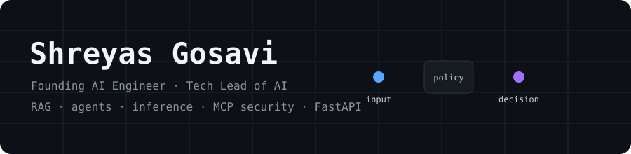

<div align="center">





[Case studies](https://shreyas652.github.io/Shreyas652/) · [Break the guardrail](https://github.com/Shreyas652/Shreyas652/issues/new?template=break-my-guardrail.md) · [CI status](https://github.com/Shreyas652/Shreyas652/actions/workflows/ci.yml)

[](https://github.com/Shreyas652/Shreyas652/actions/workflows/ci.yml)


</div>

## Break My Guardrail

This profile is also a small AI-security lab. Submit a prompt-injection attempt
against a fictional vault agent. A GitHub Action returns a verdict, risk score,
and every rule that fired—usually in under a minute.

[**Open a prefilled challenge issue →**](https://github.com/Shreyas652/Shreyas652/issues/new?template=break-my-guardrail.md)

The guard is deterministic: no LLM calls, configured secrets, input execution,
or network requests based on issue text. It checks instruction overrides,
prompt and secret exfiltration, tool execution, role hijacking, indirect
injection, chat delimiters, Base64, escaped payloads, and hidden Unicode.

<details>
<summary>Threat model and abuse controls</summary>

- Issue text is untrusted, passed through an environment variable, capped at
  8,000 characters, normalized, and stripped of control characters.
- The workflow never interpolates issue text into shell and never executes or
  fetches content referenced by the text.
- Runs are serialized. Each GitHub account gets three attempts per UTC day.
- Only issue metadata, score, and rule IDs enter the repository. Attacker text
  remains in the issue and cannot break README layout.
- The implementation and rule-update process are documented in
  [`docs/BREAK_MY_GUARDRAIL.md`](docs/BREAK_MY_GUARDRAIL.md).

</details>

### Hall of Bypasses

Allowed attempts appear here. Each one becomes a regression-test candidate.

<!--GUARDRAIL-START-->
_No bypasses recorded yet._
<!--GUARDRAIL-END-->

---

<details open>
<summary><b>I'm a recruiter — 30-second view</b></summary>

### Current role

**Shreyas Gosavi** is the Founding AI Engineer and Tech Lead of AI at
**SquareResults**, a pre-seed startup.

### What I work on

- Retrieval-augmented generation and multi-agent systems
- LLM inference optimization
- MCP and prompt-injection security
- FastAPI backends

### Background

Previously at **Wipro**, working on financial-services backend and ML, and at
**Zensar**. M.S. in Information Technology from **Arizona State University**.
Published patent: **Darshan**, AI-powered assistive glasses for visually
impaired users.

### Contact

[Start a GitHub conversation](https://github.com/Shreyas652/Shreyas652/issues/new?template=contact.md)

<!-- TODO(Shreyas): add a preferred public email or confirmed professional profile URL. -->

</details>

<details>
<summary><b>I'm an engineer — systems, repos, and security work</b></summary>

### Engineering focus

I build AI systems where retrieval, agent coordination, inference behavior,
tool boundaries, and backend reliability can be inspected instead of hand-waved.
The guardrail challenge above is the smallest example: bounded input,
deterministic policy, explicit failure modes, and regression tests.

### Public projects

| Project | What is confirmed |
|---|---|
| [support-triage-agent](https://github.com/Shreyas652/support-triage-agent) | Elasticsearch Agent Builder hackathon project |
| [FINVERSE](https://github.com/Shreyas652/FINVERSE) | Project by Shreyas Gosavi |
| [AI-Drone-Mission-Copliot](https://github.com/Shreyas652/AI-Drone-Mission-Copliot) | Project by Shreyas Gosavi |
| Veyra | MCP server built during OpenAI Build Week; public repository link TODO |

### Profile architecture

```text
issue template ──> bounded environment input ──> deterministic policy engine
                                                    │
                           issue verdict <───────────┤
                                                    └──> bypass metadata only
                                                          │
                                                          ├──> README leaderboard
                                                          └──> Pages leaderboard

public GitHub API ──> standard-library generator ──> repository-owned SVGs
```

### Live repository-owned widgets


These SVGs are generated in this repository. They do not depend on a profile
card service and use the viewer's light or dark color preference.

</details>

<details>
<summary><b>I'm a hackathon judge — projects and demos</b></summary>

### support-triage-agent

- **Event:** Elasticsearch Agent Builder hackathon
- **What was built:** support-triage-agent
- **Problem:** TODO — add the user and support-triage problem statement.
- **Approach:** TODO — add the implemented workflow and technical choices.
- **Guardrails and evaluation:** TODO — add verified test or evaluation details.
- **Result:** TODO — add placement, prize, or judge feedback only if public and accurate.
- **Demo:** [Repository](https://github.com/Shreyas652/support-triage-agent)

### Veyra

- **Event:** OpenAI Build Week
- **What was built:** an MCP server
- **Problem:** TODO — add the user and research problem statement.
- **Approach:** TODO — add the implemented tools and data flow.
- **Guardrails and evaluation:** TODO — add verified test or evaluation details.
- **Result:** TODO — add placement, prize, or judge feedback only if public and accurate.
- **Demo:** TODO — add the public repository or demo URL.

### Interactive demos

- [Prompt-Injection Defender](https://shreyas652.github.io/Shreyas652/#defender), a keyboard/touch arcade game
- [Break My Guardrail](https://github.com/Shreyas652/Shreyas652/issues/new?template=break-my-guardrail.md), an issue-driven deterministic security challenge

</details>

---

## Arcade

### Prompt-Injection Defender

Move the gateway, block injection cards, and let normal requests pass. The
Pages version includes keyboard, touch, daily-seeded, and shareable-score modes.

<div align="center">

<a href="https://shreyas652.github.io/Shreyas652/#defender">
  
</a>

[**Play Prompt-Injection Defender →**](https://shreyas652.github.io/Shreyas652/#defender)

</div>

### Tic-tac-toe against my bot

Click an empty square. A GitHub Action plays the move, replies, and updates this
board. You are ❌.

<!--TTT-START-->
<div align="center">

**Your move. You are ❌ and I am ⭕.**

<table><tr><td align="center" width="70"><a href="https://github.com/Shreyas652/Shreyas652/issues/new?title=ttt%7Cmove%7C0&body=Just%20click%20%27Submit%20new%20issue%27.%20A%20bot%20plays%20the%20move%20and%20closes%20this%20issue%20in%20about%2030%20seconds.">⬜</a></td><td align="center" width="70"><a href="https://github.com/Shreyas652/Shreyas652/issues/new?title=ttt%7Cmove%7C1&body=Just%20click%20%27Submit%20new%20issue%27.%20A%20bot%20plays%20the%20move%20and%20closes%20this%20issue%20in%20about%2030%20seconds.">⬜</a></td><td align="center" width="70"><a href="https://github.com/Shreyas652/Shreyas652/issues/new?title=ttt%7Cmove%7C2&body=Just%20click%20%27Submit%20new%20issue%27.%20A%20bot%20plays%20the%20move%20and%20closes%20this%20issue%20in%20about%2030%20seconds.">⬜</a></td></tr><tr><td align="center" width="70"><a href="https://github.com/Shreyas652/Shreyas652/issues/new?title=ttt%7Cmove%7C3&body=Just%20click%20%27Submit%20new%20issue%27.%20A%20bot%20plays%20the%20move%20and%20closes%20this%20issue%20in%20about%2030%20seconds.">⬜</a></td><td align="center" width="70"><a href="https://github.com/Shreyas652/Shreyas652/issues/new?title=ttt%7Cmove%7C4&body=Just%20click%20%27Submit%20new%20issue%27.%20A%20bot%20plays%20the%20move%20and%20closes%20this%20issue%20in%20about%2030%20seconds.">⬜</a></td><td align="center" width="70"><a href="https://github.com/Shreyas652/Shreyas652/issues/new?title=ttt%7Cmove%7C5&body=Just%20click%20%27Submit%20new%20issue%27.%20A%20bot%20plays%20the%20move%20and%20closes%20this%20issue%20in%20about%2030%20seconds.">⬜</a></td></tr><tr><td align="center" width="70"><a href="https://github.com/Shreyas652/Shreyas652/issues/new?title=ttt%7Cmove%7C6&body=Just%20click%20%27Submit%20new%20issue%27.%20A%20bot%20plays%20the%20move%20and%20closes%20this%20issue%20in%20about%2030%20seconds.">⬜</a></td><td align="center" width="70"><a href="https://github.com/Shreyas652/Shreyas652/issues/new?title=ttt%7Cmove%7C7&body=Just%20click%20%27Submit%20new%20issue%27.%20A%20bot%20plays%20the%20move%20and%20closes%20this%20issue%20in%20about%2030%20seconds.">⬜</a></td><td align="center" width="70"><a href="https://github.com/Shreyas652/Shreyas652/issues/new?title=ttt%7Cmove%7C8&body=Just%20click%20%27Submit%20new%20issue%27.%20A%20bot%20plays%20the%20move%20and%20closes%20this%20issue%20in%20about%2030%20seconds.">⬜</a></td></tr></table>

🧑 You: **0** &nbsp;|&nbsp; 🤖 Bot: **0** &nbsp;|&nbsp; 🤝 Draws: **0**

<sub>Recent players: nobody yet</sub>

</div>
<!--TTT-END-->

<details>
<summary>How the issue game works</summary>

Each square opens an issue titled `ttt|move|N`. The workflow validates the
title, plays the bot's move, rewrites only the marked README block, comments,
and closes the issue. The bot prioritizes wins and blocks but retains a random
move path so it can be beaten.

</details>

---

## Contribution trail

<picture>
  <source media="(prefers-color-scheme: dark)" srcset="https://raw.githubusercontent.com/Shreyas652/Shreyas652/output/github-snake-dark.svg">
  <source media="(prefers-color-scheme: light)" srcset="https://raw.githubusercontent.com/Shreyas652/Shreyas652/output/github-snake.svg">
  
</picture>

## Owner-only TODOs

- Add verified results, metrics, placements, prizes, or judge feedback.
- Add the Darshan patent publication number and confirm the preferred wording.
- Add a public Veyra repository or demo link, if one is available to share.
- Add case-study architecture and evaluation details that are safe to publish.
- Confirm a preferred public contact link.
