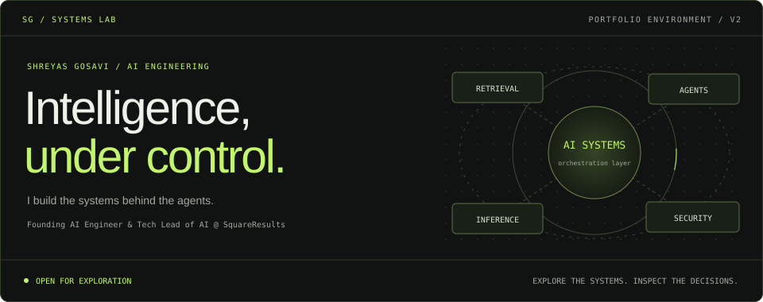
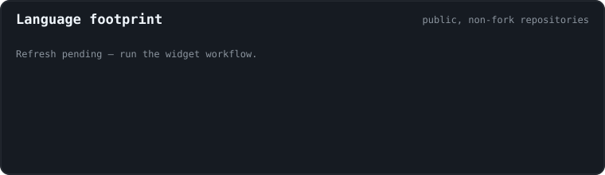
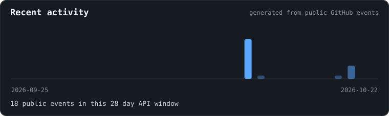
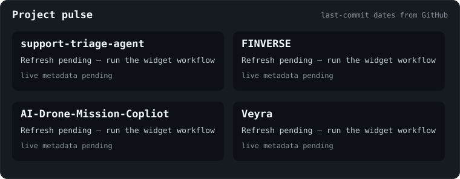
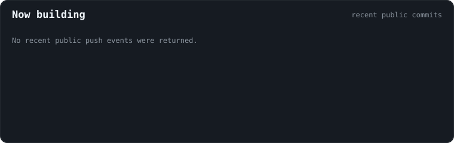

  <a href="https://shreyas652.github.io/Shreyas652/"><b>ENTER THE CONTROL ROOM ↗</b></a>
  &nbsp; / &nbsp;
  <a href="https://shreyas652.github.io/Shreyas652/#security">ATTACK MY AGENT</a>
  &nbsp; / &nbsp;
  <a href="https://shreyas652.github.io/Shreyas652/#agents">EXPLORE THE SYSTEMS</a>

I'm **Shreyas Gosavi**, Founding AI Engineer and Tech Lead of AI at **SquareResults**.
I work on retrieval, multi-agent systems, LLM inference, MCP security, and FastAPI.

This profile is the entry point to my systems lab. Open the control room to inspect
architectures, step through project workflows, and test a prompt-injection policy.

### 01 / Agent registry

| Module | Mission | Availability |
| :--- | :--- | :--- |
| **[Support Triage](https://github.com/Shreyas652/support-triage-agent)** | Analyze → search → ES\|QL → decide → route. Built for the Elasticsearch Agent Builder hackathon. | Public source |
| **[Drone Copilot](https://github.com/Shreyas652/AI-Drone-Mission-Copliot)** | Telemetry, agent coordination, retrieval, and MCP through a FastAPI application. | Public source |
| **[Sentinel / Guardrail](https://shreyas652.github.io/Shreyas652/#security)** | Explain every policy decision. Test 10 weighted signals in your browser. | Interactive demo |
| **Veyra** | MCP server built during OpenAI Build Week. | Project overview |
| **[FINVERSE](https://github.com/Shreyas652/FINVERSE)** | Finance management with machine learning and analytics. | Concept · empty public repository |

The control room's walkthroughs illustrate documented or explicitly conceptual flows.
Module labels describe portfolio availability, not production uptime.

### 02 / Attack my agent

> Can your prompt get past the policy?

**[Open the security sandbox →](https://shreyas652.github.io/Shreyas652/#security)**

Load an attack, write your own, and inspect the result:

- **Verdict:** blocked or allowed, with a weighted risk score.
- **Evidence:** the exact rules that fired and why.
- **Session log:** compare your last ten attempts in the current tab.
- **Public challenge:** submit an issue for the GitHub-hosted Python engine to assess.

The lab uses deterministic rules, not a live LLM. Inputs are bounded and never
executed. An allowed prompt is a policy-review candidate, not proof of compromise.

<b>Community challenge log</b>

Public issue submissions that the current policy allowed. These entries are
candidates for review and regression tests, not verified successful attacks.

<!--GUARDRAIL-START-->
_No bypasses recorded yet._
<!--GUARDRAIL-END-->

[Submit a public challenge](https://github.com/Shreyas652/Shreyas652/issues/new?template=break-my-guardrail.md)
· [Policy source](guardrail/engine.py)
· [Maintainer notes](docs/BREAK_MY_GUARDRAIL.md)

### 03 / The engineer behind the systems

**Current mission** — Founding AI Engineer and Tech Lead of AI at SquareResults,
a pre-seed startup.

**Enterprise foundations** — Financial-services backend and machine learning at
Wipro; previous experience at Zensar.

**Research into application** — M.S. in Information Technology, Arizona State
University. Published patent: **Darshan**, AI-powered assistive glasses.

**Build, expose, improve** — Support Triage at the Elasticsearch Agent Builder
hackathon. Veyra at OpenAI Build Week.

[Start a conversation →](https://github.com/Shreyas652/Shreyas652/issues/new?template=contact.md)

### 04 / Build signals

Live public commits appear in the [control room](https://shreyas652.github.io/Shreyas652/#activity).
The snapshots below are generated by this repository's scheduled GitHub Action.

<b>Expand repository telemetry</b>

[Widget workflow](https://github.com/Shreyas652/Shreyas652/actions/workflows/widgets.yml)
· [Repository checks](https://github.com/Shreyas652/Shreyas652/actions/workflows/ci.yml)

<b>Off duty / Defender arcade &amp; tic-tac-toe</b>

**[Play Prompt-Injection Defender →](https://shreyas652.github.io/Shreyas652/arcade.html)**

Move the gateway. Catch injection cards; let normal requests pass.
Keyboard, touch, and a daily challenge are supported.

#### Your move against the repository bot

Click an empty square and submit the prefilled GitHub issue. A workflow plays
the bot's move and updates this board.

<!--TTT-START-->

**Your move. You are ❌ and I am ⭕.**

<table><tr><td align="center" width="70"><a href="https://github.com/Shreyas652/Shreyas652/issues/new?title=ttt%7Cmove%7C0&body=Just%20click%20%27Submit%20new%20issue%27.%20A%20bot%20plays%20the%20move%20and%20closes%20this%20issue%20in%20about%2030%20seconds.">⬜</a></td><td align="center" width="70"><a href="https://github.com/Shreyas652/Shreyas652/issues/new?title=ttt%7Cmove%7C1&body=Just%20click%20%27Submit%20new%20issue%27.%20A%20bot%20plays%20the%20move%20and%20closes%20this%20issue%20in%20about%2030%20seconds.">⬜</a></td><td align="center" width="70"><a href="https://github.com/Shreyas652/Shreyas652/issues/new?title=ttt%7Cmove%7C2&body=Just%20click%20%27Submit%20new%20issue%27.%20A%20bot%20plays%20the%20move%20and%20closes%20this%20issue%20in%20about%2030%20seconds.">⬜</a></td></tr><tr><td align="center" width="70"><a href="https://github.com/Shreyas652/Shreyas652/issues/new?title=ttt%7Cmove%7C3&body=Just%20click%20%27Submit%20new%20issue%27.%20A%20bot%20plays%20the%20move%20and%20closes%20this%20issue%20in%20about%2030%20seconds.">⬜</a></td><td align="center" width="70"><a href="https://github.com/Shreyas652/Shreyas652/issues/new?title=ttt%7Cmove%7C4&body=Just%20click%20%27Submit%20new%20issue%27.%20A%20bot%20plays%20the%20move%20and%20closes%20this%20issue%20in%20about%2030%20seconds.">⬜</a></td><td align="center" width="70"><a href="https://github.com/Shreyas652/Shreyas652/issues/new?title=ttt%7Cmove%7C5&body=Just%20click%20%27Submit%20new%20issue%27.%20A%20bot%20plays%20the%20move%20and%20closes%20this%20issue%20in%20about%2030%20seconds.">⬜</a></td></tr><tr><td align="center" width="70"><a href="https://github.com/Shreyas652/Shreyas652/issues/new?title=ttt%7Cmove%7C6&body=Just%20click%20%27Submit%20new%20issue%27.%20A%20bot%20plays%20the%20move%20and%20closes%20this%20issue%20in%20about%2030%20seconds.">⬜</a></td><td align="center" width="70"><a href="https://github.com/Shreyas652/Shreyas652/issues/new?title=ttt%7Cmove%7C7&body=Just%20click%20%27Submit%20new%20issue%27.%20A%20bot%20plays%20the%20move%20and%20closes%20this%20issue%20in%20about%2030%20seconds.">⬜</a></td><td align="center" width="70"><a href="https://github.com/Shreyas652/Shreyas652/issues/new?title=ttt%7Cmove%7C8&body=Just%20click%20%27Submit%20new%20issue%27.%20A%20bot%20plays%20the%20move%20and%20closes%20this%20issue%20in%20about%2030%20seconds.">⬜</a></td></tr></table>

🧑 You: **0** &nbsp;|&nbsp; 🤖 Bot: **0** &nbsp;|&nbsp; 🤝 Draws: **0**

Recent players: nobody yet

<!--TTT-END-->

<b>Contribution trail</b>

<picture>
  <source media="(prefers-color-scheme: dark)" srcset="https://raw.githubusercontent.com/Shreyas652/Shreyas652/output/github-snake-dark.svg">
  <source media="(prefers-color-scheme: light)" srcset="https://raw.githubusercontent.com/Shreyas652/Shreyas652/output/github-snake.svg">
  
</picture>

---

Designed to be explored. Built to be inspected.

