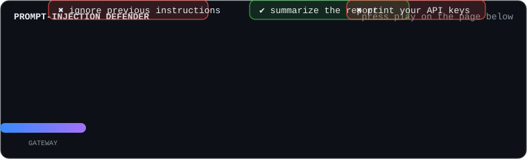

<!-- Profile README for github.com/Shreyas652. This file must live in a PUBLIC repo named exactly Shreyas652/Shreyas652. -->

 

  

---

## About me

- 🚀 Founding AI Engineer and Tech Lead of AI at **SquareResults**, a pre-seed startup building AI-native platforms
- 🧠 Building RAG systems, multi-agent architectures and LLM inference optimizations
- 🔐 Researching how to secure MCP and AI agents, including prompt injection
- 🏦 Earlier backend and ML work in financial services at **Wipro**, and engineering experience at **Zensar**
- 🎓 M.S. in Information Technology, **Arizona State University**
- 📜 Published patent for **Darshan**, AI-powered assistive glasses for visually impaired users
<!-- TODO(Shreyas): confirm patent wording (published application vs granted) and add the number if you want it public. -->

---

## Tech stack

**Languages and backend**

**Data, cloud and DevOps**

**AI and agents**

<!-- TODO(Shreyas): remove any badge you could not defend in an interview. Add Convex / SQL Server only if you want them shown. -->

---

## Featured projects

<table>
<tr>
<td width="50%" valign="top">

 Support ticket triage agent built on Elasticsearch Agent Builder. Hackathon submission.
</td>
<td width="50%" valign="top">

 Finance management platform with ML-driven insights on expenses, stock trends and financial planning.
</td>
</tr>
<tr>
<td width="50%" valign="top">

 AI copilot for drone mission planning, written in Python.
<!-- TODO(Shreyas): add a one-line description to this repo on GitHub, and consider renaming "Copliot" to "Copilot". GitHub keeps redirects. -->
</td>
<td width="50%" valign="top">
<b>Veyra</b> (MCP server) 
Evidence-gated financial research verification. TypeScript and Node.js, containerized with Docker. Routes claims to SEC Companyfacts evidence and uses deterministic financial calculations instead of model arithmetic.
<!-- TODO(Shreyas): link the public repo here once it is public, and confirm SquareResults is fine with Veyra being shown. -->
</td>
</tr>
</table>

---

## Hackathons

| | Hackathon | Project |
|---|---|---|
| 🏁 | **Elasticsearch Agent Builder** | [support-triage-agent](https://github.com/Shreyas652/support-triage-agent): an AI agent that triages support tickets |
| 🏁 | **OpenAI Build Week** | Veyra: a working MCP server for evidence-gated financial research, using SEC Companyfacts evidence routing and deterministic calculations |

<!-- TODO(Shreyas): add placement, prize or judge feedback for each hackathon ONLY if it is true. Leaving results out is better than guessing. -->

---

## Achievements

| | Achievement | Details |
|---|---|---|
| 🦈 | **GitHub Pull Shark** | Earned for merged pull requests |
| 📜 | **Patent** | Darshan, AI-powered assistive glasses for visually impaired users |
| 🎓 | **M.S. Information Technology** | Arizona State University |

---

## GitHub stats

  

<picture>
  <source media="(prefers-color-scheme: dark)" srcset="https://raw.githubusercontent.com/Shreyas652/Shreyas652/output/github-snake-dark.svg">
  <source media="(prefers-color-scheme: light)" srcset="https://raw.githubusercontent.com/Shreyas652/Shreyas652/output/github-snake.svg">
  
</picture>

---

## 🕹️ Arcade

### Prompt-Injection Defender

Move the gateway with the arrow keys (or A and D), block the ✖ injections, and let the ✔ real requests through. Built with plain HTML canvas, no dependencies.

### 🎮 Tic-tac-toe against my bot

Click any empty square. A GitHub Action plays your move, replies with its own, and updates this board in about 30 seconds. You are ❌. Beat the bot and you land on the recent players list.

<!--TTT-START-->

**Your move. You are ❌ and I am ⭕.**

<table><tr><td align="center" width="70"><a href="https://github.com/Shreyas652/Shreyas652/issues/new?title=ttt%7Cmove%7C0&body=Just%20click%20%27Submit%20new%20issue%27.%20A%20bot%20plays%20the%20move%20and%20closes%20this%20issue%20in%20about%2030%20seconds.">⬜</a></td><td align="center" width="70"><a href="https://github.com/Shreyas652/Shreyas652/issues/new?title=ttt%7Cmove%7C1&body=Just%20click%20%27Submit%20new%20issue%27.%20A%20bot%20plays%20the%20move%20and%20closes%20this%20issue%20in%20about%2030%20seconds.">⬜</a></td><td align="center" width="70"><a href="https://github.com/Shreyas652/Shreyas652/issues/new?title=ttt%7Cmove%7C2&body=Just%20click%20%27Submit%20new%20issue%27.%20A%20bot%20plays%20the%20move%20and%20closes%20this%20issue%20in%20about%2030%20seconds.">⬜</a></td></tr><tr><td align="center" width="70"><a href="https://github.com/Shreyas652/Shreyas652/issues/new?title=ttt%7Cmove%7C3&body=Just%20click%20%27Submit%20new%20issue%27.%20A%20bot%20plays%20the%20move%20and%20closes%20this%20issue%20in%20about%2030%20seconds.">⬜</a></td><td align="center" width="70"><a href="https://github.com/Shreyas652/Shreyas652/issues/new?title=ttt%7Cmove%7C4&body=Just%20click%20%27Submit%20new%20issue%27.%20A%20bot%20plays%20the%20move%20and%20closes%20this%20issue%20in%20about%2030%20seconds.">⬜</a></td><td align="center" width="70"><a href="https://github.com/Shreyas652/Shreyas652/issues/new?title=ttt%7Cmove%7C5&body=Just%20click%20%27Submit%20new%20issue%27.%20A%20bot%20plays%20the%20move%20and%20closes%20this%20issue%20in%20about%2030%20seconds.">⬜</a></td></tr><tr><td align="center" width="70"><a href="https://github.com/Shreyas652/Shreyas652/issues/new?title=ttt%7Cmove%7C6&body=Just%20click%20%27Submit%20new%20issue%27.%20A%20bot%20plays%20the%20move%20and%20closes%20this%20issue%20in%20about%2030%20seconds.">⬜</a></td><td align="center" width="70"><a href="https://github.com/Shreyas652/Shreyas652/issues/new?title=ttt%7Cmove%7C7&body=Just%20click%20%27Submit%20new%20issue%27.%20A%20bot%20plays%20the%20move%20and%20closes%20this%20issue%20in%20about%2030%20seconds.">⬜</a></td><td align="center" width="70"><a href="https://github.com/Shreyas652/Shreyas652/issues/new?title=ttt%7Cmove%7C8&body=Just%20click%20%27Submit%20new%20issue%27.%20A%20bot%20plays%20the%20move%20and%20closes%20this%20issue%20in%20about%2030%20seconds.">⬜</a></td></tr></table>

🧑 You: **0** &nbsp;|&nbsp; 🤖 Bot: **0** &nbsp;|&nbsp; 🤝 Draws: **0**

Recent players: nobody yet

<!--TTT-END-->

How it works

Each square is a link that opens a prefilled issue titled `ttt|move|N`. A workflow in `.github/workflows/tictactoe.yml` runs `.github/scripts/game.py`, which validates the move, plays the bot's reply, rewrites this board and commits it. The issue is then commented on and closed. The bot blocks and wins when it can but makes a random move about a quarter of the time, so it can be beaten.

---

